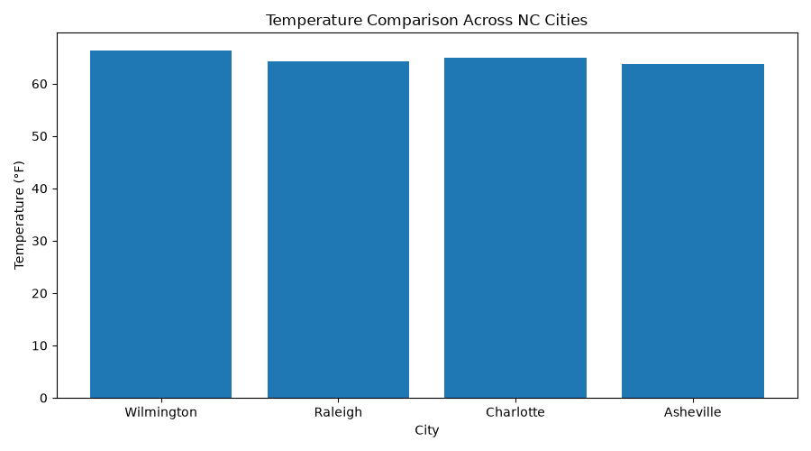

# Weather Data Collection & Analysis

**Python | APIs | pandas | Matplotlib | Data Engineering**

## Project Overview

This project collects current weather observations from the Open-Meteo API for four North Carolina cities: Wilmington, Raleigh, Charlotte, and Asheville.

The goal is to demonstrate how Python can retrieve real-world data, organize it into a structured dataset, and create visualizations for exploratory analysis.

## Tools & Technologies

- Python
- Open-Meteo API
- Requests
- pandas
- Matplotlib
- CSV

## Project Workflow

1. Retrieve temperature and wind speed measurements using the Open-Meteo API.
2. Collect observations for four North Carolina cities.
3. Organize the results into a pandas DataFrame.
4. Export the observations to `data/weather_data.csv`.
5. Generate a temperature comparison chart using Matplotlib.

## Results

Weather observations collected on October 23, 2026:

| City | Temperature (°F) | Wind Speed (mph) |
|---|---:|---:|
| Wilmington | 66.4 | 6.2 |
| Raleigh | 64.2 | 5.7 |
| Charlotte | 64.9 | 4.9 |
| Asheville | 63.8 | 6.1 |

Wilmington recorded the highest temperature, while Asheville recorded the lowest temperature in this four-city snapshot.



## Project Structure

```text
Weather-Data-Pipeline/
├── data/
│   └── weather_data.csv
├── figures/
│   └── temperature_comparison.png
├── scripts/
│   ├── collect_weather.py
│   └── analyze_weather.py
└── README.md
```

## How to Run

Install the required libraries:

```powershell
py -m pip install requests pandas matplotlib
```

Collect weather observations:

```powershell
py .\scripts\collect_weather.py
```

Generate the visualization:

```powershell
py .\scripts\analyze_weather.py
```

Run the commands from the project's root directory.

## Limitations

- The dataset contains one weather snapshot per city, not historical weather trends.
- The Open-Meteo API may return different values when the script is run again.
- The four-city comparison is exploratory and cannot establish long-term climate differences.

## Skills Demonstrated

Python programming, REST API requests, JSON processing, data collection, pandas DataFrames, CSV exports, data visualization, and exploratory analysis.

**Data source:** [Open-Meteo](https://open-meteo.com/)
